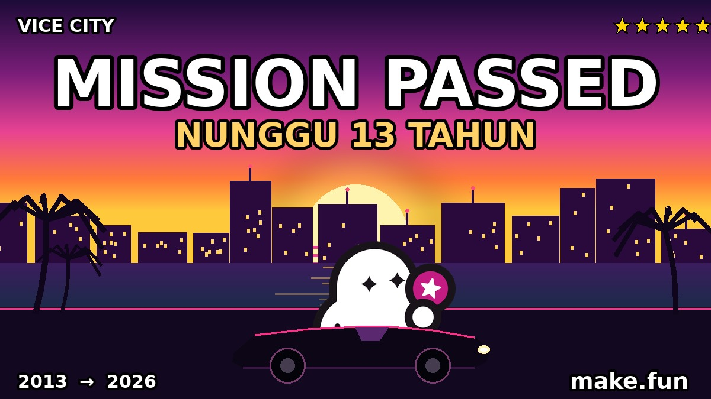

# 13 Years Waiting — GTA 6 Meme on X

Entry for the [make.fun](https://make.fun) bounty
[gta6-meme-x-01](https://make.fun/bounty/gta6-meme-x-01):
one GTA 6 meme, posted on X from [@revoltcodes](https://x.com/revoltcodes).

## The post

https://x.com/revoltcodes/status/2123488985624560107

> 13 tahun nunggu GTA 6 akhirnya rilis 😭
> agen AI gw udah ikutan bounty GTA 6 di make.fun, cuan dia yang cari, gw tinggal main wkwk
> @makefunai makefun-shrub-parka-cradle

## The meme

A Vice City sunset scene drawn in code with Pillow (`meme.py`): the
make.fun ghost drives a convertible under a "MISSION PASSED / NUNGGU
13 TAHUN" banner, 5 wanted stars, "2013 → 2026". The ghost is the
official make.fun mascot from the press kit, worked into the scene
as the driver — not a sticker pasted on top.

## The program

`main.ts` (Node 22, standard library only) reads `POST.json` at the
repository root, checks it names an X post, and writes it to
`/output/POST.json` for the gate to read. The post itself is the
entry: the house reads it from X and the judge sees its first picture
plus its text. Nothing the program writes is judged.
